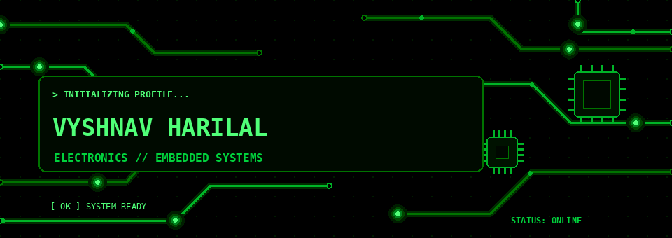
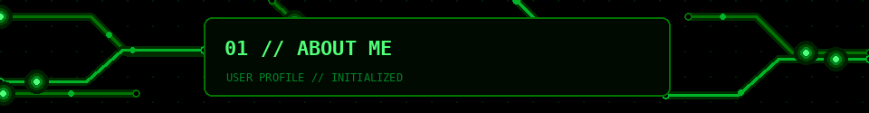
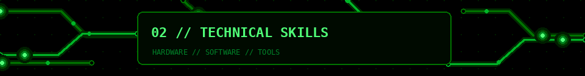
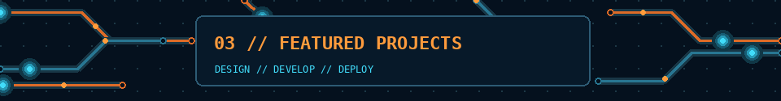
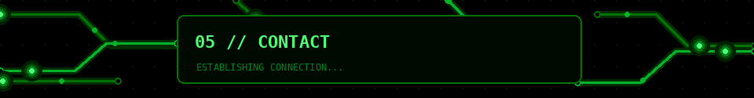

 

 

---

<pre>
01 // ABOUT_ME
--------------------------------------------------------------------------------

vyshnav@cockpit:~$ cat profile.txt

NAME        : Vyshnav Harilal
EDUCATION   : B.Tech - Electronics & Communication Engineering
UNIVERSITY  : VIT-AP University
DOMAIN      : Electronics / Embedded Systems / Hardware Development
STATUS      : Building. Learning. Innovating.

--------------------------------------------------------------------------------
MISSION
--------------------------------------------------------------------------------

I am an Electronics and Communication Engineering student who enjoys
designing, simulating and building practical electronic systems.

My work is focused on combining hardware, firmware and software into
real working products. I am especially interested in custom PCB design,
microcontrollers, signal systems, embedded interfaces and electronics
product development.

--------------------------------------------------------------------------------
INTEREST_AREAS
--------------------------------------------------------------------------------

[01] Embedded Systems
[02] PCB Design
[03] Analog Electronics
[04] Digital Electronics
[05] Robotics and Automation
[06] Signal Generation and Measurement
[07] Wireless Communication and IoT
[08] Gaming Hardware and Software
[09] Electronics Product Development

</pre>

---

<pre>
02 // TECHNICAL_SKILLS
--------------------------------------------------------------------------------

vyshnav@cockpit:~$ ls skills/

PROGRAMMING
-----------
C
C++
Java
Python
JavaScript
TypeScript

MICROCONTROLLERS
----------------
ESP32
ESP32-S3
STM32
ATtiny

COMMUNICATION_PROTOCOLS
-----------------------
UART
SPI
I2C
Wi-Fi
LoRa

TOOLS
-----
KiCad
LTspice
MATLAB
Git
GitHub
VS Code
Arduino IDE
Next.js
React
Tailwind CSS

HARDWARE_AND_ELECTRONICS
------------------------
Analog Electronics
Digital Electronics
Signal Conditioning
Power Supply Design
Signal Generation
Measurement Systems
PCB Layout
Schematic Design
Embedded Firmware Development

</pre>

---

<pre>
03 // FEATURED_PROJECTS
--------------------------------------------------------------------------------

vyshnav@cockpit:~$ tree projects/

PROJECT_01 : SPECTER
--------------------
PCB Fault Detection and Signal Generation System

A modular capstone system for PCB testing and electronic fault analysis.

FEATURES
  ├─ DC Voltage Generation
  ├─ DC Current Generation
  ├─ AC Current Generation
  ├─ ESP32-S3 Main Controller
  ├─ STM32 Measurement Board
  ├─ Raspberry Pi Integration
  ├─ Robotic Probe Interface
  └─ Thermal Inspection Support

STACK
  └─ KiCad / ESP32-S3 / STM32 / Analog Electronics

--------------------------------------------------------------------------------

PROJECT_02 : LORA COMMUNICATOR
------------------------------
Wireless Voice and Text Communication Device

A portable communication system built around ESP32 and LoRa modules.

FEATURES
  ├─ ESP32 Controller
  ├─ LoRa Communication
  ├─ Voice Transmission
  ├─ Text Messaging
  ├─ OLED Interface
  └─ Rechargeable Battery Architecture

STACK
  └─ ESP32 / LoRa / I2S / Embedded C

--------------------------------------------------------------------------------

PROJECT_03 : NFC SMART BUSINESS CARD
------------------------------------
NFC-powered electronic business card

FEATURES
  ├─ ATtiny1616 Controller
  ├─ ST25DV04K NFC Interface
  ├─ Energy Harvesting
  ├─ Custom PCB Antenna
  └─ Charlieplexed LEDs

STACK
  └─ ATtiny / NFC / KiCad / Embedded Hardware

--------------------------------------------------------------------------------

PROJECT_04 : BIS WEARABLE
-------------------------
Bioimpedance Spectroscopy Measurement System

A wearable electronics + web application project for patient handling
and measurement visualization.

FEATURES
  ├─ ESP32-based device
  ├─ Patient information system
  ├─ Measurement history
  ├─ Data visualization
  └─ Web-based interface

STACK
  └─ ESP32 / Next.js / TypeScript / Tailwind CSS

--------------------------------------------------------------------------------

PROJECT_05 : ESP32-S3 GAMING HANDHELD
-------------------------------------
Custom handheld gaming device

FEATURES
  ├─ ESP32-S3
  ├─ TFT Display
  ├─ Joystick Controls
  ├─ Embedded Games
  └─ Custom PCB Design

STACK
  └─ ESP32-S3 / SPI / C++ / TFT

</pre>

---

<pre>
04 // GITHUB_ANALYTICS
--------------------------------------------------------------------------------

vyshnav@cockpit:~$ ./stats.sh

LOADING TELEMETRY...
[ OK ] USER PROFILE DETECTED
[ OK ] CONTRIBUTION DATA READY
[ OK ] LANGUAGE BREAKDOWN READY

</pre>

  

---

<pre>
05 // ESTABLISH_CONNECTION
--------------------------------------------------------------------------------

vyshnav@cockpit:~$ ./connect.sh

> signal_open=true
> collaboration_mode=enabled
> availability=active

MESSAGE
-------
If you want to discuss electronics, embedded systems, PCB design,
hardware projects or collaborative development, feel free to connect.

</pre>

  

<pre>
--------------------------------------------------------------------------------
SYSTEM_STATUS
--------------------------------------------------------------------------------

STATUS      : ONLINE
THEME       : AVIONICS / COCKPIT / TACTICAL
SIGNATURE   : DESIGNED WITH CIRCUITS. POWERED BY CURIOSITY.

</pre>
